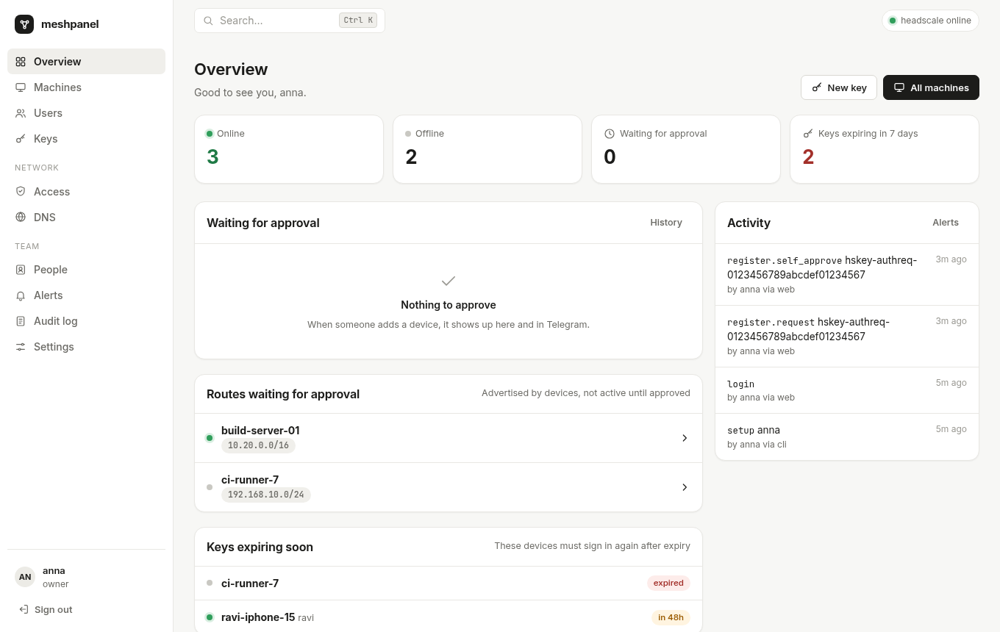
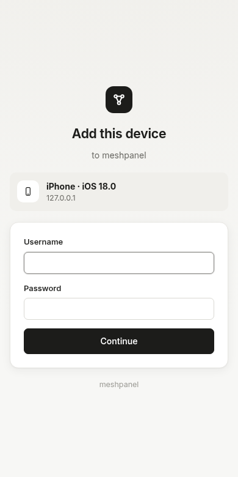
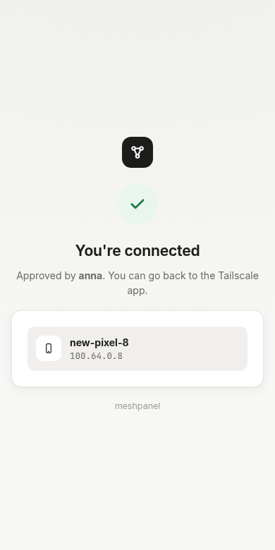
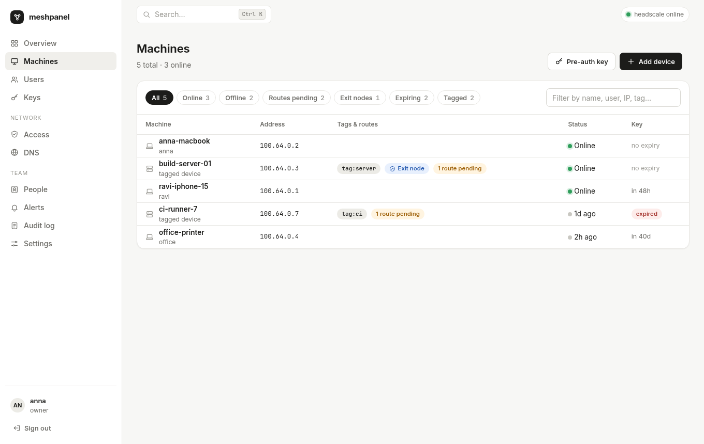
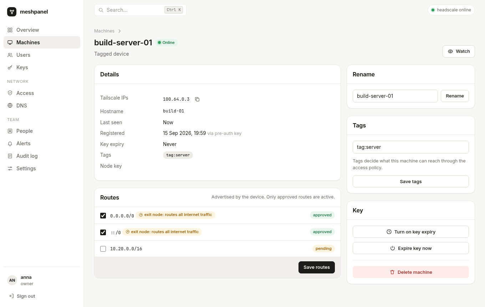
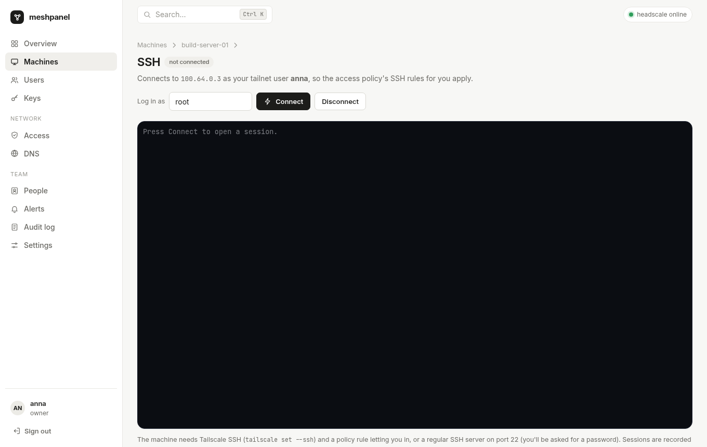

<p align="center"></p>

<h1 align="center">meshpanel</h1>

<p align="center"><b>A control panel for <a href="https://github.com/juanfont/headscale">headscale</a> that lets people add their own phones and laptops, with no terminal involved.</b><br>
Device approvals in the browser or on Telegram, local accounts with two-factor, roles for teams, and a live dashboard. One Go binary.</p>

<p align="center"></p>

---

## Why

With plain headscale, adding a phone works like this:

1. You type the server URL into the Tailscale app.
2. The app shows `headscale auth register --auth-id … --user …`.
3. Someone has to SSH into the server and run that command with sudo.

meshpanel replaces that last step:

1. The person signs in on the phone with **their own account** (password plus authenticator code).
2. Approvers get a **Telegram message with Approve / Deny buttons**, or approve in the dashboard.
3. The phone joins. Every copy of the Telegram card updates to "Approved by anna".

People who are allowed to approve their own devices skip the wait.

<p align="center">
  
  &nbsp;
  
</p>

## Features

- **Terminal-free device registration.** meshpanel serves its own `/register/<id>` and `/auth/<id>` (SSH check) pages: sign in, 2FA, then approval. Requests are approved exactly once, even when two admins tap at the same moment.
- **Add-a-device helper.** A page that builds the exact `tailscale up` command (or `docker run`) for Linux, macOS, Windows and Docker, with routes, exit node, SSH, tags and an optional pre-auth key.
- **Telegram bot.**
  - People link their own Telegram account.
  - Approval cards carry single-use buttons, and every tap re-checks the person's current permissions.
  - An optional group chat can also receive approval cards.
- **Watch rules.** Alerts for a device, a user, a tag, or everything:
  - online / offline
  - new device
  - key expiring / expired
  - route advertised
  - not seen for N hours
  - …

  Offline alerts are debounced, flapping devices are collapsed into one message, and each person can set quiet hours. Security alerts always come through.
- **Local accounts.**
  - argon2id passwords, with mandatory TOTP two-factor and backup codes.
  - Login lockout, a session list with revoke, and invite links.
  - Nobody can grant more permissions than they hold.
- **Roles and permissions:** owner, admin, network admin, IT admin, auditor, viewer and member, plus extra permissions per person. Members only see their own devices, everywhere: lists, search, live updates and alerts.
- **Everything Headplane does**, except the Docker and Kubernetes integrations:
  - **Machines:** rename, tags, routes with exit-node and wide-subnet warnings, key expiry, delete.
  - **Users and pre-auth keys:** keys come with a QR code and per-OS setup steps.
  - **Access policy:** a visual editor plus a HuJSON editor, with download and upload. Changes are checked with headscale, shown as a diff, then applied.
  - **DNS:** MagicDNS, nameservers, split DNS and extra records. Changes are written to `config.yaml` with comments kept, a backup is taken, and headscale is restarted. The old file is restored if headscale doesn't come back.
- **Device info (optional).** A small built-in tailnet node reads each machine's OS, model, Tailscale version and endpoints, and shows them in the machine list and detail page.
- **Browser SSH terminal (optional).** Open a shell on a machine from the dashboard.
  - Each session joins the tailnet as **your own headscale user** (a short-lived node, deleted afterwards), so Tailscale SSH rules apply to you, not to the panel.
  - Works with Tailscale SSH and with a regular sshd (you're prompted for a password).
  - When an SSH rule requires a fresh check (`"action": "check"`), the terminal shows an **Approve sign-in** button instead of timing out.
  - Sessions are recorded in the audit log.
- **Live UI.** The browser updates over WebSocket and falls back to polling. There's a <kbd>Ctrl</kbd>+<kbd>K</kbd> command palette.
- **Webhooks** for Slack, Discord, or any HTTP endpoint. Generic JSON payloads are HMAC-signed, and delivery is retried. Loopback, link-local and cloud-metadata targets are refused.
- **Device limit.** An optional cap on devices per user. People at the cap can still request more, but an approver has to OK them.
- **Audit log** of every change: who made it, through which channel (web, Telegram or CLI), and before/after values. It can be exported to CSV.
- **Three themes:** Paper (default), Midnight and Console, plus "follow system". Each person picks their own. Admins can set a company accent color and logo.
- **Small and self-contained.**
  - A single static binary (about 30 MB, including the embedded Tailscale client for the optional features) with pure-Go SQLite.
  - No Node, Docker or CDN.
  - Idles at about 40 MB of RAM. The optional agent adds roughly 15 MB, and each open SSH session adds a little more while it's open.

<p align="center">
  
  
</p>

## Requirements

- **headscale 0.30 or newer.** meshpanel talks to headscale's HTTP API over its local unix socket, which needs no API key. Older headscale versions speak gRPC on the socket and are refused at startup.
- meshpanel runs **on the same machine** as headscale.
- A reverse proxy (Caddy, nginx, …) that already terminates HTTPS for headscale. meshpanel serves plain HTTP on port 8030.

## Quick start

```sh
# 1. Install. Packages from the releases page create the user and service:
sudo dpkg -i meshpanel_*_amd64.deb       # or: rpm -i meshpanel_*.rpm
#    …or download just the binary (also meshpanel_linux_arm64, meshpanel_linux_armv7):
#    curl -Lo meshpanel https://github.com/velixio/meshpanel/releases/latest/download/meshpanel_linux_amd64
#    sudo install -m 0755 meshpanel /usr/bin/meshpanel

# 2. Configure
sudoedit /etc/meshpanel/config.yaml      # set session_secret and public_url
#    session_secret: openssl rand -hex 32

# 3. Route three paths to meshpanel in your proxy (examples below), then:
sudo systemctl enable --now meshpanel
sudo -u meshpanel meshpanel doctor        # checks socket, version, files, proxy

# 4. Open https://headscale.example.com/admin/setup to create the owner account.
#    It asks for the one-time setup code printed in the log: journalctl -u meshpanel | grep setup_code
```

### Reverse proxy

meshpanel needs three paths on headscale's public URL. Everything else keeps going to headscale.

| Path | Goes to |
|---|---|
| `/register/*`, `/auth/*` | meshpanel (phone sign-in and approval pages) |
| `/admin/*` | meshpanel (dashboard) |
| everything else | headscale |

**Caddy** ([deploy/Caddyfile](deploy/Caddyfile)):

```caddy
headscale.example.com {
	@meshpanel path /register/* /auth/* /admin /admin/*
	reverse_proxy @meshpanel 127.0.0.1:8030
	reverse_proxy 127.0.0.1:8080
}
```

For **nginx**, see [deploy/nginx.conf](deploy/nginx.conf). Keep the `Host` header and the WebSocket upgrade headers.

### Telegram

1. Create a bot with [@BotFather](https://t.me/BotFather) and put its token in `telegram.token` (or `telegram.token_path`).
2. Restart meshpanel.
3. Each person opens **Alerts → Link Telegram** and taps the link. Approvers get approval cards from then on.
4. Optional: add the bot to a group, then set the group's id under **Settings → Telegram**.

The bot uses long polling, so it needs no webhook or extra proxy route.

### Device info and browser SSH

Both are off by default. Turn them on in the config:

```yaml
agent:
  enabled: true        # joins the tailnet as headscale user "meshpanel"
web_ssh:
  enabled: true        # sessions join as the signed-in person's headscale user
```

- **Agent visibility:** with a restrictive access policy, let the agent see devices. Ping is enough:

  ```json
  {"action": "accept", "src": ["meshpanel@"], "dst": ["*:*"], "proto": "icmp"}
  ```

- **Browser SSH:** the target machine needs Tailscale SSH (`tailscale set --ssh`) plus an `ssh` rule for the person, or a normal SSH server on port 22.
- **Who can use it:** the new `web_ssh` permission. Members have it for their own devices; viewers and auditors don't.



### DNS and policy editing

- **DNS:** set `headscale.config_path` and give meshpanel's group write access to that file. meshpanel restarts headscale through `headscale.restart_command`. The default uses `sudo`; install [deploy/sudoers](deploy/sudoers), or use the polkit rule in [docs/install.md](docs/install.md).
- **Policy, database mode** (`policy.mode: database`): edits go through headscale's API.
- **Policy, file mode:** meshpanel writes the policy file and runs `headscale.reload_command`.

## How device approval works

```
phone ──► https://hs.example.com/register/hskey-authreq-…   (proxy → meshpanel)
            sign in (password + 2FA)
            ├─ may approve own devices? ─► headscale: POST /api/v1/auth/register ─► connected
            └─ otherwise ─► pending request ─► Telegram cards + dashboard
                                                └─ approver taps Approve ─► register ─► phone page updates
```

- Requests expire after about 15 minutes, matching headscale's cache.
- A denied request is rejected in headscale straight away, so the phone stops waiting.

## Configuration

Everything is in one YAML file. [deploy/config.example.yaml](deploy/config.example.yaml) documents every key.

- Every key can be overridden with an environment variable, for example `MESHPANEL_SERVER_LISTEN=:8030` or `MESHPANEL_TELEGRAM_TOKEN=…`.
- Secrets can be read from files with `session_secret_path` and `token_path`.

## CLI

```
meshpanel serve   [-c config.yaml]           run the panel
meshpanel setup   -u NAME [--hs-user NAME]   create the first owner from the terminal
meshpanel user reset-2fa NAME                when someone lost their phone and backup codes
meshpanel user set-password NAME
meshpanel user list
meshpanel backup  DEST                       consistent copy of the SQLite database
meshpanel doctor                             check the installation end to end
meshpanel version
```

## Security notes

- **Phone sign-in links:** opening `/register/<id>` never changes anything. Confirming takes a CSRF-protected button, and the page warns against links someone else sent.
- **2FA:** TOTP secrets are encrypted with a key derived from `session_secret`, and each code works once. Changing `session_secret` invalidates 2FA secrets; fix that with `meshpanel user reset-2fa`.
- **Sign-in limits:** throttling is per IP and per account+IP. The per-account limit is gentle, so one attacker can't lock a user out everywhere.
- **Sessions:** server-side, with `HttpOnly` and `SameSite=Lax` cookies. Sessions expire after 7 days idle and 30 days at the most. Logging in issues a fresh session token after 2FA.
- **Requests:** every form is CSRF-protected and cross-origin requests are refused. The CSP allows scripts from meshpanel itself only.
- **Telegram:**
  - Buttons are random single-use action ids stored on the server. The data inside a button grants nothing by itself.
  - Taps are authorized per person, even in group chats.
  - Every decision is audited with its channel.
- **Proxies:** `X-Forwarded-For` is honored only from `server.trusted_proxies`.
- **Secrets:** meshpanel refuses to start with a short or example `session_secret`.

Report vulnerabilities as described in [SECURITY.md](SECURITY.md).

## Roadmap

- OIDC sign-in alongside local accounts
- Session recording for browser SSH

## Development

```sh
make test        # unit and HTTP tests
make run         # build and run with the example config
make lint size   # gofmt/vet, and keep the binary under 40 MB (built with TSTAGS)
```

The UI uses server-rendered Go templates plus htmx, with no build step. CSS lives in `internal/web/static/css`: theme tokens in `tokens.css`, components in `app.css`. See [CONTRIBUTING.md](CONTRIBUTING.md).

## License

MIT. Embedded fonts and htmx are listed in [THIRD_PARTY_NOTICES.md](THIRD_PARTY_NOTICES.md).
